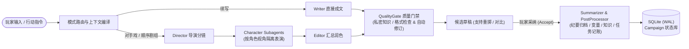

# StoryForge

**StoryForge** 是一个面向长程叙事的 **AI 多 Agent 协作写作与角色扮演引擎**（支持 **Android** 与 **Windows** 桌面端）。

与传统的单次对话聊天壳不同，StoryForge 以可持续演进的 **故事战役（Campaign）** 为核心状态源，将 **SillyTavern 角色卡、世界书（World Info）、角色实例、动态变量、任务追踪、多层剧情纪要（Chronicle）与长短期记忆** 纳入统一的工程化运行时，通过多角色隔离演绎与后处理记账，解决长篇互动叙事中的“人设崩塌、私密视角串戏、状态遗忘与历史污染”痛点。

---

## ✨ 核心特性

- 🎬 **多 Agent 剧组式写作管线**
  - **三种生成档位**：支持 **续写**（单次快速成文，默认）、**对手戏**（双人焦点互动）与 **顺序剧组**（多角色出场大场面）。
  - **职责解耦**：由 **Director（导演）** 规划分镜与出场调度 → **Character Subagent（角色子代理）** 在视角隔离的上下文中独立演绎言行与心理 → **Editor（执笔/编剧）** 汇总成文 → **QualityGate（质量门禁）** 自动校验视角越界、格式泄漏并支持 1× 自动修订（Auto-fix）。
- 🧠 **分层记忆与私密知识归属（Provenance）**
  - **Chronicle A / B / C 三层纪要**：每轮自动生成本轮明细摘要（Chronicle A），随轮次推进自动压缩为阶段纪要（B）与全局主线纪要（C）。
  - **Context Compiler & 混合召回**：结合关键词、向量语义检索与 `ContextEpoch` 缓存对齐，按角色认知边界动态编译上下文，严防角色“全知全能”或偷看他人的私密设定。
- 🔒 **事务级轮次屏障与分支演进**
  - **草稿与定稿隔离**：每轮生成支持多次重掷（Reroll）与版本切换；仅当用户点击 **采纳（Accept）** 后，**Summarizer（摘要器）** 与 **PostProcessor（后处理器）** 才会提取新知识、变量变更与任务进度并原子化落盘。
  - **不可变历史与末尾分叉**：已采纳的正文受前缀保护不可直接篡改，支持从已采纳轮次创建平行故事分支（Fork），或导出包含源角色卡与完整状态的 `v3 Campaign Bundle` 快照。
- 🧩 **SillyTavern 生态兼容与安全沙箱**
  - 原生支持导入/导出 SillyTavern `.png` / `.json` 角色卡与世界书，支持卡片正则（Regex）展示转换。
  - 支持 **MVU（MagVarUpdate）状态栏原生解析渲染**、卡片内联/远程界面（`sandbox="allow-scripts"` 不透明源隔离 iframe + 子帧 IPC 封堵守卫）及受权限门控的第三方 Manifest 插件。
- 🩺 **Meta Agent 诊断与调试工作台**
  - 内置独立于正文生成的 **Meta Agent**，提供剧情状态解释、设定冲突诊断、状态补丁建议（Patch Session）与全链路 LLM 调用追踪。

---

## 🏗️ 架构概览



---

## 📦 下载与安装

前往 [**GitHub Releases**](https://github.com/shis23/story/releases) 下载最新预编译安装包（当前发布版本：`v0.1.2`）：

| 平台 | 安装包类型 | 安装说明 |
| :--- | :--- | :--- |
| **Windows (x64)** | `StoryForge_*_x64-setup.exe` / `*.msi` | 双击安装即可。由于开源构建暂未购买商业代码签名证书，首次运行若弹出 Windows SmartScreen 提示，点击 **「更多信息 → 仍要运行」** 即可。 |
| **Android (arm64)** | `app-arm64-release.apk` | 适用于 64 位 ARM 安卓设备，允许「安装未知来源应用」后直接安装。 |

> **校验和说明**：Release 页面提供构建产物的 SHA-256 校验文件（`SHA256SUMS*.txt`），下载后可核对文件哈希以确保完整性。

---

## 🚀 快速开始（本地开发）

### 环境要求
- **操作系统**：Windows 11（桌面端开发与门禁脚本运行环境）
- **Node.js**：`v22+`（CI 锁定 `22.12.0`）
- **Rust**：`stable`（Rust Edition 2024）

### 启动开发环境

1. 安装前端依赖并启动 Vite 开发服务器（固定端口 `1420`）：
   ```powershell
   cd frontend
   npm ci
   npm run dev
   ```
2. 另开一个终端启动 Tauri 桌面端宿主：
   ```powershell
   cd crates/tauri-app
   cargo tauri dev
   ```
   *(或者在 Git Bash 下直接运行根目录的 `./dev.sh` 一键拉起前后端。)*

### 运行测试与质量门禁

项目内置 11 步确定性发布门禁（涵盖密钥扫描、Pester 发布合同、Rust 格式与严格 Clippy、全量工作区单测/集成测试、前端逻辑/组件/CSP/移动端布局测试及生产构建）：

```powershell
# 运行完整 11 步门禁（需安装 Pester、PyYAML==6.0.2 及 Playwright Chromium）
powershell -NoProfile -ExecutionPolicy Bypass -File .\scripts\verify-release.ps1
```

也可以按模块单独执行常用检查：

```powershell
# Rust 格式化、静态检查与全工作区测试
cargo fmt --all -- --check
cargo clippy --workspace --all-targets -- -D warnings
cargo test --workspace

# 前端单元测试、UI 组件测试与生产构建
cd frontend
npm test
npm run test:ui
npm run build
```

---

## 📂 代码库结构

本仓库采用 **Rust Workspace（18 个 Crate）+ Tauri v2 + Vue 3 (Pinia / Vite / Tailwind v4)** 架构：

```text
crates/
├── domain                 # 核心领域模型、Turn 状态机、Chronicle、NarrativeContract、LLM DTO
├── app-agent              # Agent 运行时、工具调用循环、提示词组装、质量门与后处理解析
├── app-pipeline           # Director → Subagent → Editor 多档位写作编排管线
├── app-conversation       # 对话树、候选变体（Variant）、知识归属（Provenance）
├── app-memory             # 摘要归档、向量/关键词混合检索与 Context Compiler
├── app-meta               # Meta Agent 诊断、MVU 规则分析、状态补丁会话
├── app-logging            # 结构化遥测、LLM 调用详情记录与脱敏导出
├── app-service            # 宿主无关的应用服务层与 JSON/SQLite 组合根（不依赖 Tauri）
├── infra-llm              # OpenAI-compatible 流式/非流式客户端、重试与工具协议降级
├── infra-sqlite           # 默认 SQLite (WAL) 存储实现、Schema 迁移、备份与只读快照导出
├── infra-st-import        # SillyTavern 角色卡（PNG/JSON）与世界书解析导入
├── infra-plugin           # 第三方插件清单校验、权限门控与审计日志
├── infra-vector           # 嵌入向量索引与相似度检索
├── infra-regex            # 安全的正则替换引擎
├── infra-common           # 原子文件 IO、凭证引用（SecretRef）与通用基础设施
├── tauri-app              # Tauri v2 桌面/移动端外壳（179 个 Command）、系统安全凭据库、卡片壳协议
├── dsh-bridge             # DSH 插件版（实验性 PoC）的 stdio JSON-RPC Sidecar
└── harness-real-llm       # 确定性仿真与真实模型端到端评估套件

frontend/                  # Vue 3 + Pinia + Tailwind v4 前端应用（桌面与移动端自适应）
integrations/
└── dsh-storyforge/        # DSH 宿主集成插件（实验性 PoC）
docs/                      # 架构设计、领域规格、用户指南与发布验收文档
scripts/                   # 发布门禁、安全扫描与自动化验证脚本
```

---

## 📚 文档导航

| 文档 | 内容说明 |
| :--- | :--- |
| [**用户使用指南 (`docs/USER-GUIDE.md`)**](docs/USER-GUIDE.md) | 首次配置模型连接、导入角色卡、三种写作模式使用、分支与快照备份说明 |
| [**系统架构说明 (`docs/ARCHITECTURE.md`)**](docs/ARCHITECTURE.md) | 分层架构、模块边界、核心数据流与设计原则 |
| [**技术设计文档 (`docs/TECHNICAL_DESIGN.md`)**](docs/TECHNICAL_DESIGN.md) | 写作管线、状态一致性、错误处理与关键技术决策 |
| [**数据模型规格 (`docs/DATA_MODEL.md`)**](docs/DATA_MODEL.md) | Campaign、Character、Turn、Chronicle 及 SQLite 存储结构定义 |
| [**Agent 接口契约 (`docs/AGENT_INTERFACES.md`)**](docs/AGENT_INTERFACES.md) | Director、Subagent、Editor、Summarizer、PostProcessor 与 Meta Agent 契约 |
| [**记忆与上下文编译器 (`docs/MEMORY-CONTEXT-COMPILER-SPEC-2026-07-11.md`)**](docs/MEMORY-CONTEXT-COMPILER-SPEC-2026-07-11.md) | Chronicle A/B/C 压缩层级与上下文动态组装规格 |
| [**Prompt 与缓存优化 (`docs/ARCHITECTURE-PROMPT-CACHE-OPTIMIZATION-2026-07-11.md`)**](docs/ARCHITECTURE-PROMPT-CACHE-OPTIMIZATION-2026-07-11.md) | `ContextEpoch` 稳定性与前缀缓存命中率优化设计 |
| [**前端组件架构 (`docs/FRONTEND-COMPONENTS.md`)**](docs/FRONTEND-COMPONENTS.md) | Vue 3 前端视图、Store 状态管理与 Tauri IPC 接线说明 |
| [**变量与状态系统 (`docs/CAMPAIGN-VARIABLES.md`)**](docs/CAMPAIGN-VARIABLES.md) | Campaign 变量、MVU 状态栏解析与卡片壳交互机制 |
| [**产品路线图 (`docs/ROADMAP.md`)**](docs/ROADMAP.md) | 阶段演进记录与后续规划 |
| [**当前发布状态 (`docs/RELEASE-STATUS.md`)**](docs/RELEASE-STATUS.md) | 当前版本（`0.1.2`）验收范围、门禁实测记录与已知限制边界 |
| [**发布检查清单 (`docs/RELEASE-CHECKLIST.md`)**](docs/RELEASE-CHECKLIST.md) | 发版前质量门禁与真机验证核对清单 |
